<picture>
  <source media="(prefers-color-scheme: dark)" srcset="./assets/source-dark.svg" />
  
</picture>

I work directly with non-technical stakeholders—product owners, business analysts, biology researchers—and turn their problems into shipped production systems. Over **2+ years** I've built features for an enterprise Vue / C# .NET / SQL Server platform deployed in **100+ countries**, delivered custom integrations and data migrations, and deployed AI features including a RAG-based Voice AI answering Vietnamese questions from English PDFs with citations. I graduate in **2026** with a B.S. in Computer Science: Software Engineering from Liberty University.

```ts
const loc: Engineer = {
  name: "Loc Nguyen",
  role: "Software Engineer",
  company: "Vietnamese Baptist Church",
  yearsShipping: 2,
  languages: ["C#", "Python", "SQL", "TypeScript", "JavaScript", "C++"],
  stack: [".NET 9", "ASP.NET Core", "Entity Framework Core", "FastAPI", "PyTorch", "Detectron2", "Vue 3", "React"],
  focus: "Full-stack engineer modernizing .NET platforms used in 100+ countries",
  career: [
    { at: "Vietnamese Baptist Church", role: "AI Software Engineer (Volunteer)", when: "Sep 2026 – Present" },
    { at: "OneHope", role: "Junior Software Engineer (Full Stack)", when: "Jan 2025 – Sep 2026" },
    { at: "OneHope", role: "Software Engineer Intern", when: "May 2024 – Aug 2024" },
  ],
  education: "B.S. in Computer Science: Software Engineering, Liberty University",
};
```

## `projects.map(explain)`

<details>
<summary><code>projects.aiFollicleDetector()</code> Led a 6-person team delivering a cell-imaging tool for a university biology lab</summary>

- Gathered requirements from researchers and fine-tuned Mask R-CNN (Detectron2) to automate manual follicle counts used to judge treatments
- Scored the model against a held-out test set of **126 follicles**, detecting **112** (F1 **0.89**)
- Prevented data leakage with a splitter keeping each of **29 animals** in one split within **0.5 points** of a 60/20/20 split target (50/17/17 images)
- Stack: Python, Detectron2, PyTorch, CVAT SDK, FastAPI, Docker

</details>

<details>
<summary><code>projects.vulnPriorityEngine()</code> Turn a scanner's flat CVE dump into a risk-ranked, SLA-bucketed remediation queue</summary>

- Uses EPSS exploit-probability + CISA KEV + asset criticality to prioritize vulnerabilities
- Transforms unstructured scanner output into actionable remediation tasks

</details>

<details>
<summary><code>projects.advancedRagLlmApp()</code> Self-contained implementation of an advanced AI application combining RAG, vector search, and LLM APIs</summary>

- Combines Retrieval-Augmented Generation (RAG), vector search, document ingestion, and prompt orchestration
- Stack: Python, CSS, HTML, JavaScript, Dockerfile, Makefile

</details>

<details>
<summary><code>projects.netcodeArena()</code> Server-authoritative multiplayer netcode: a 2-player arena with client-side prediction</summary>

- Implements server reconciliation and snapshot interpolation, tested under injected latency and packet loss
- Engine-agnostic .NET core architecture
- Stack: C#, Docker, GitHub Actions, UDP networking, xUnit

</details>

<details>
<summary><code>projects.fieldOpsSqlCostAudit()</code> Tested, layered analytical-SQL codebase computing cost-to-serve and technician utilization</summary>

- Computes cost-to-serve, technician utilization, and SLA-breach rates over messy field-ops data
- Surfaced in live Tableau dashboards
- Stack: Python, SQL, dbt, PostgreSQL, Tableau, Dockerfile

</details>

<details>
<summary><code>projects.contextLens()</code> Engineers waste time re-deriving why code is written a certain way</summary>

- Surfaces tribal knowledge from PR comments and commit messages directly in the source line they explain
- Stack: TypeScript, Git log/blame parsing, GitHub REST API, SQLite, VS Code Extension API

</details>

## `CHANGELOG.md`

### v3.0 · Vietnamese Baptist Church
*Sep. 2026 – Present*

**Shipped** a production PWA for **20+ users** with live chat, push notifications, and RAG-based Voice AI answering Vietnamese questions from English PDFs with citations, isolating each tenant's data via Postgres RLS.

**Built and deployed** a resilient AI microservice with multi-provider failover and exponential backoff on Oracle Cloud using Docker, ensuring **99.9% uptime** during LLM outages; cut pgvector search from **1.2s to 0.25s** using connection pools.

**Ran** user acceptance interviews with congregation members, translated their feedback into a prioritized backlog, and documented expected behavior per feature, so every release shipped against criteria the users had approved beforehand.

### v2.0 · OneHope
*Jan. 2025 – Sep. 2026*

**Shipped** internal developer tooling across **14 .NET repos**: a flag-gated request tracer (OpenTelemetry, Jaeger) making any slow request traceable from client to server to exact SQL; **3 teammates** used it to cut load times **50–70%** on **3 pages**.

**Improved** the Planning dashboard load time **20x** (10s to 0.5s) and cut its chart's database reads **93%** by fixing a badly misplanned SQL Server query and removing duplicate API calls, verifying no result or permission changed.

**Remediated** a critical security vulnerability by optimizing O(n²) algorithms to O(n) and adding request throttling to prevent CPU exhaustion attacks, while delivering **40+ other production features and fixes** across C# .NET services.

### v1.0 · OneHope
*May 2024 – Aug. 2024*

**Executed** a complex data migration recovery with a Python ETL pipeline on the Bynder API, restoring **150,000 asset relationships** for **22,666 assets** and saving research and marketing teams an estimated **200+ hours** of manual re-linking.

**Delivered** **15+ production features and fixes** by connecting data sources to an enterprise reporting engine, enforcing row-level security, debugging SQL generation errors, and writing automated unit tests in Azure DevOps CI/CD pipelines.

## `npm ls --depth=0`

<p align="center">
  
</p>

## `contact()`

[`email`](mailto:loc.software.dev@gmail.com) · [`linkedin`](https://linkedin.com/in/lock-nguyen) · [`website`](https://loc-nguyen.netlify.app/) · [`github`](https://github.com/LockNguyen)

## Projects

- [vuln-priority-engine](https://github.com/LockNguyen/vuln-priority-engine) — Turn a scanner's flat CVE dump into a risk-ranked, SLA-bucketed remediation queue using EPSS exploit-probability + CISA KEV + asset criticality.
- [supply-chain-optimizer](https://github.com/LockNguyen/supply-chain-optimizer) — AI-powered inventory management system that predicts demand 8 weeks ahead, optimizes stock levels, and reduces carrying costs by 40%.
- [advanced-rag-llm-app](https://github.com/LockNguyen/advanced-rag-llm-app) — This project is a self-contained summer-internship-level implementation of an advanced AI application that combines Retrieval-Augmented Generation (RAG)…
- [fraud-detection-system](https://github.com/LockNguyen/fraud-detection-system) — Protecting $20B+ in annual e-commerce transactions with ML-powered fraud detection
- [elt-pipeline-dbt-snowflake-airflow](https://github.com/LockNguyen/elt-pipeline-dbt-snowflake-airflow) — A production-grade ELT pipeline that extracts data from multiple public APIs (Reddit, OpenWeather, and a SaaS PostgreSQL database), loads raw data into…
- [netcode-arena](https://github.com/LockNguyen/netcode-arena) — Server-authoritative multiplayer netcode: a 2-player arena with client-side prediction, server reconciliation, and snapshot interpolation, tested under…
- [field-ops-sql-cost-audit](https://github.com/LockNguyen/field-ops-sql-cost-audit) — A tested, layered analytical-SQL codebase computing cost-to-serve, technician utilization, and SLA-breach rates over messy field-ops data, surfaced in live…
- [contextlens](https://github.com/LockNguyen/contextlens) — Engineers waste significant time re-deriving why code is written a certain way — the tribal knowledge lives in PR comments and commit messages disconnected…
- [talentflow-recruitment](https://github.com/LockNguyen/talentflow-recruitment) — Smart Recruitment That Reduces Time-to-Hire by 50%
- [flavormetrics-restaurant-analytics](https://github.com/LockNguyen/flavormetrics-restaurant-analytics) — Data-Driven Restaurant Management That Boosts Profits by 23%
